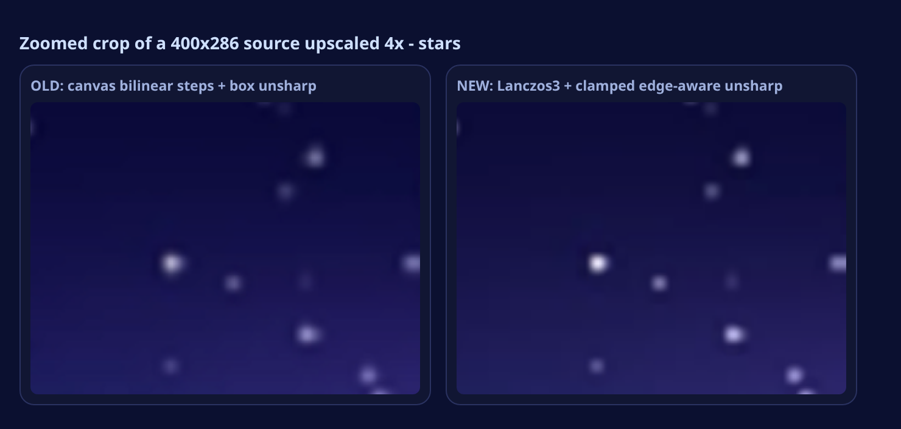

<div align="center">


**Upscale any photo to 4K on your phone — inside a glass UI that moves in 4D.**

[](#install)
[](#install)
[](#how-it-works)
[](#)

</div>

---

Glass Enhancer 4K is a small, fast Android app that takes a low-resolution image and rebuilds it at up to 4096 px on the long edge. Everything runs on the device — no server, no upload, no account. The interface is a layered glassmorphism stack with a real 4D depth system: cards sit at different Z depths, so the whole scene rotates, shifts and parallaxes under your finger or your phone's tilt sensor.


## Features

**Enhance**
- 1K / 2K / 3K / 4K output, picked in one tap
- **High quality** mode resamples with a Lanczos3 filter and anti-ringing clamping, so edges stay crisp without halos or blocky steps
- **Fast** mode uses the browser's own scaler when you want a result instantly
- Sharpness (clamped, edge-aware unsharp mask), Denoise, Contrast and Colour saturation sliders — all live
- Before/after compare slider with a draggable divider
- Shows the exact source and output dimensions, and how long the pass took

**Glass**
- Glass transparency and backdrop-blur amount are both adjustable, live

**4D depth**
- `4D Depth` scales every layer's Z translation and the rotation strength
- `Parallax tilt` sets how far the scene rotates in response to the pointer
- Floating glass orbs at three different depths drift at different rates — true parallax, not a shadow trick

**Motion**
- Bounce controls the spring overshoot on the entry animation and every tap
- Anim speed scales the whole animation timeline

**Also**
- Gyroscope tilt control (uses the device orientation sensor, permission handled)
- Dark and light themes, follows your system setting by default
- Drag and drop on desktop browsers
- Sample photo bundled so the app is usable the second it opens

## Why the pixels used to break — and what changed in 1.1.0

The first version upscaled with the browser's `drawImage` (bilinear), then applied a very strong box unsharp mask. Bilinear leaves stair-stepping on diagonals, and an unclamped unsharp mask turns that stepping into halos: bright fringes on one side of an edge, dark rings on the other. On a JPEG source it also amplifies the 8×8 block grid. That is the "crunchy / pixelated" look.

Version 1.1.0 replaces the whole core:



- **Lanczos3 resampling** instead of bilinear, done as a separable two-pass filter with a proper support window.
- **Anti-ringing clamping** — Lanczos has negative lobes, which is where its sharpness comes from and also where dark rings come from. Every output pixel is clamped to the range of its two nearest source samples, so the filter can sharpen but can never overshoot into a halo. This is the standard trick used by high-end video scalers.
- **Clamped, edge-aware unsharp mask** — the detail boost is reduced on strong edges (where halos form) and kept on texture, and the result is clamped to the local 5-pixel min/max. The detail response is also soft-limited, so point highlights stop ringing.
- **Edge-aware denoise** only smooths flat areas, never edges.
- **No shadow lifting** — tone mapping is neutral, so blacks stay black.
- The work runs in row bands with `await` between them, so the progress counter keeps updating instead of the UI freezing.

## Install

1. Download `GlassEnhancer4K-v1.1.0.apk` from the [Releases](../../releases) page.
2. On your phone, open the file. Android will ask you to allow installs from this source — allow it for your browser or file manager.
3. Install and open. No permissions are requested up front; camera and gallery access is only used when you tap the drop zone, and saving goes through the system MediaStore into `Pictures/GlassEnhancer`.

Requirements: Android 7.0 (API 24) or newer. The APK is self-signed, so Play Protect may show a "scan" prompt for a sideloaded build — that is normal for any app distributed outside the Play Store.

## Screenshots

| | | |
|:--:|:--:|:--:|
| <br>**Home** | <br>**4K result + compare** | <br>**Glass controls** |
| <br>**Tilt: pointer top-left** | <br>**Tilt: pointer bottom-right** | <br>**Motion controls** |


The depth screenshots are the same app at two different pointer positions — the cards, the header pill and the floating orbs all rotate and shift by different amounts, which is what produces the 4D feel.

## How it works

The app is a single-activity Android shell around one self-contained HTML file. The shell is a `WebView` with JavaScript and DOM storage enabled; the whole interface, the enhancement pipeline and the animation engine live in `app/src/main/assets/index.html`.

**Upscaling.** In *High quality* mode the pixels are resampled by a separable Lanczos3 filter written in plain JavaScript: weights are precomputed once per axis, the horizontal pass runs into an intermediate buffer, then the vertical pass produces the final image. Both passes clamp every output value to the min/max of its two nearest source samples, which removes the ringing that a raw Lanczos kernel would produce. Alpha is dropped when the image is fully opaque, which saves a quarter of the work. In *Fast* mode the browser's own scaler does the geometry in 2× steps.

**Detail pass.** A separable 1-2-1 blur produces a low-pass copy, and each pixel is compared against it. The boost is scaled down where the local gradient is high, soft-limited so single bright points cannot ring, and clamped to the 5-neighbour min/max. Denoise mixes toward the blur only in flat regions. Finally saturation and contrast are applied around the luminance, and the whole thing is written back with the browser's own clamping.

**Progress.** Every pass is split into row bands of roughly 1.5 M pixels with a `await` between bands, so the button label and status pill keep updating instead of the tab locking up.

**4D depth and parallax.** A `pointermove` (or `deviceorientation`) handler writes normalised `-1…1` values into two CSS custom properties. A `requestAnimationFrame` loop smooths them with a spring (`vx = (vx + (target - current) * 0.05) * damping`), so movement overshoots slightly and settles — that is the bounce slider. Those properties feed three things at once:

```css
.scene   { transform: rotateX(calc(var(--ty) * var(--tilt) * var(--depth) * -1deg))
                     rotateY(calc(var(--tx) * var(--tilt) * var(--depth) * 1deg)); }
.z1      { transform: translateZ(calc(var(--depth) * 46px)); }
.orb.o1  { transform: translate3d(calc(var(--tx) * var(--depth) * -70px),
                                  calc(var(--ty) * var(--depth) * -70px),
                                  calc(var(--depth) * 96px)); }
```

Because each layer has its own Z and its own parallax coefficient, the header, the preview card, the control panel and the orbs separate visually as the scene turns. The glass effect itself is `backdrop-filter: blur() saturate()` plus an inset highlight and a specular radial gradient that tracks the pointer.

**Saving.** In a browser the app falls back to a normal `<a download>` of the canvas PNG. Inside the app, a `@JavascriptInterface` bridge receives the same data URI, decodes it and writes it through `MediaStore` into `Pictures/GlassEnhancer` — so no storage permission is needed on Android 10+.

## Build from source

You need a JDK 17 and the Android SDK (build-tools 34, platform 34). The repo ships a plain `aapt2` → `javac` → `d8` → `apksigner` script, so Gradle is not required:

```bash
export JAVA_HOME=/path/to/jdk-17
export ANDROID_HOME=/path/to/android-sdk
bash build.sh          # writes build/GlassEnhancer4K-v1.1.0.apk
```

`build.sh` creates a release keystore on first run if one is not present and signs the APK with it. For a build you intend to publish, sign with your own key instead.

To work on the interface alone, just open `app/src/main/assets/index.html` in a browser — no build step. A `?demo=1` query string exposes the state hooks used to capture the screenshots (`demo=1&load=1&tab=d&tx=-0.62&ty=-0.34&tilt=17&depth=1.45`).

## Project layout

```
app/src/main/
  AndroidManifest.xml
  java/com/hubclue/glassenhancer4k/MainActivity.java   WebView shell, file chooser, save bridge
  assets/index.html                                    the entire app: UI, pipeline, 4D engine
  assets/sample.jpg                                    bundled sample photo
  res/                                                 launcher icons, theme, strings
screenshots/                                           captured from the app at 430×932 @2x
build.sh                                               SDK-only build, no Gradle
```

## Notes and limits

- The enhancement is a classic resample + unsharp-mask pipeline, not a neural super-resolution model. It sharpens and enlarges very well, and it no longer produces halos or blocky steps; it still cannot invent detail that was never in the frame. A 4K output of a very small source will look crisp but soft in texture — that is the honest result of any non-ML upscaler.
- *High quality* on a 12-megapixel output takes a few seconds on a mid-range phone. *Fast* is near-instant.
- Very large sources at 4K can take a few seconds on older phones; the progress counter updates as it goes.
- The sample photo is procedurally generated, so the repo carries no third-party image licensing.

## License

MIT — see [LICENSE](LICENSE).
