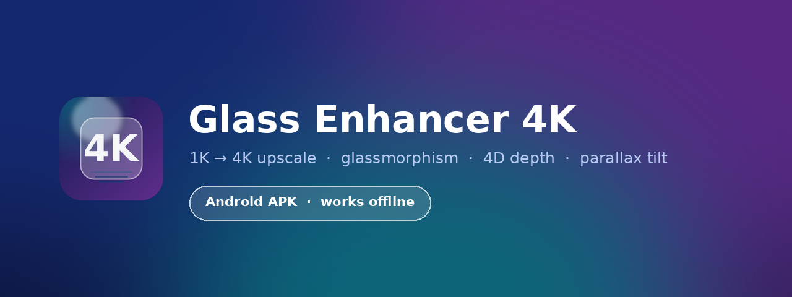
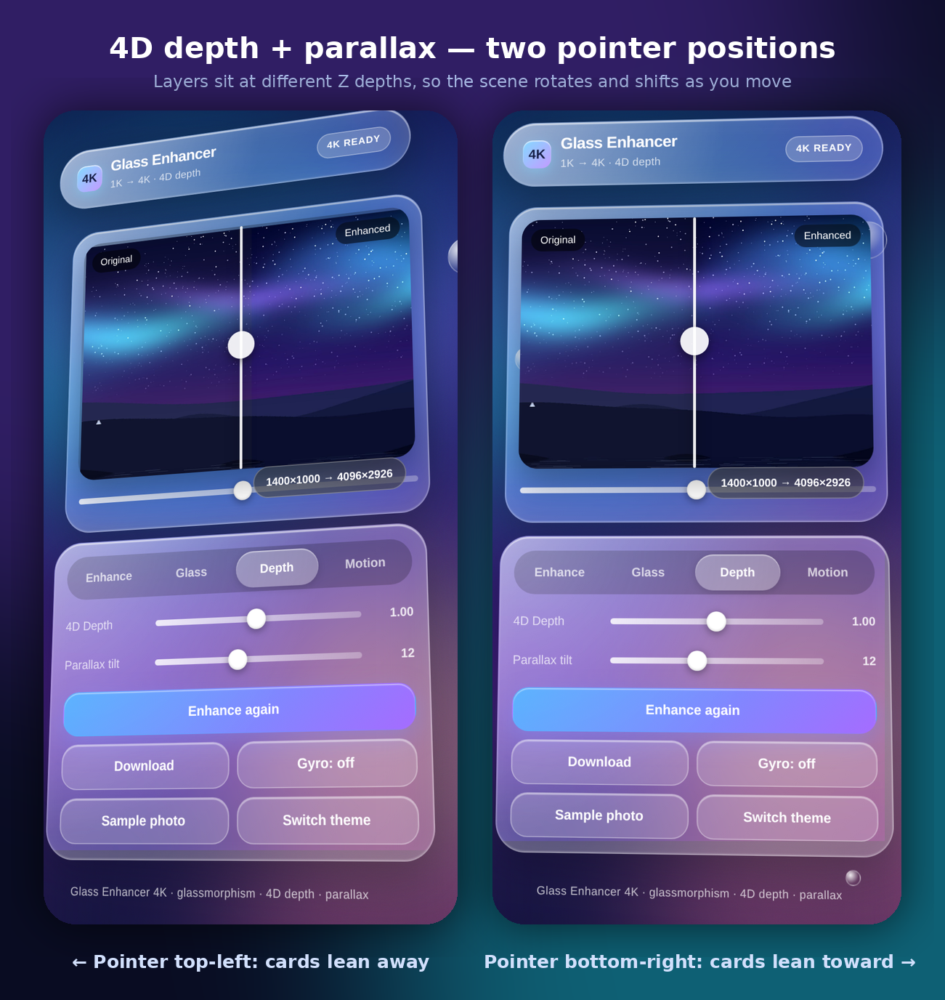
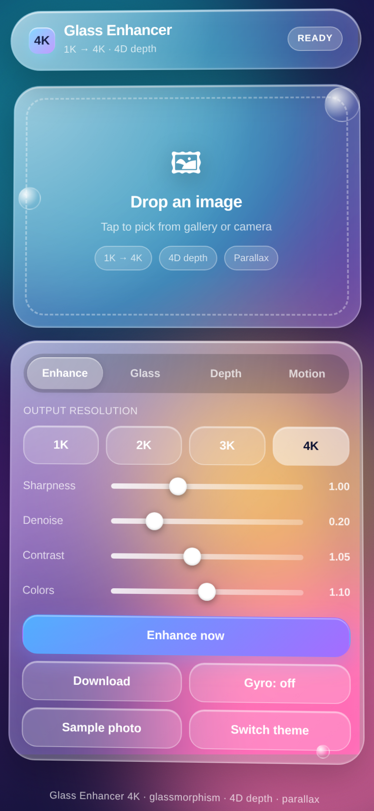
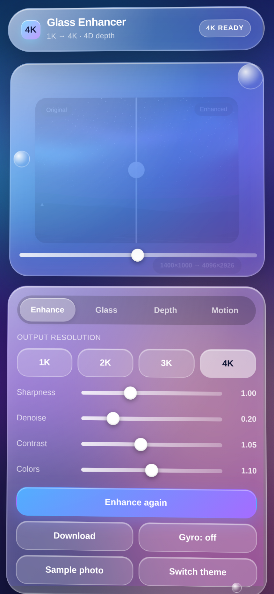
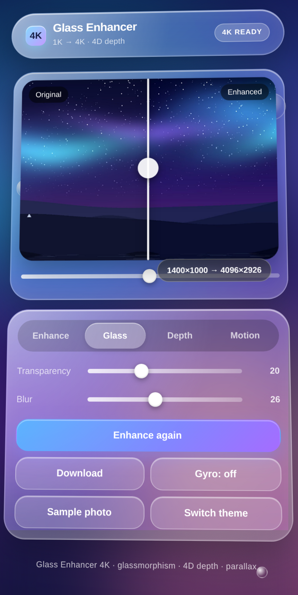
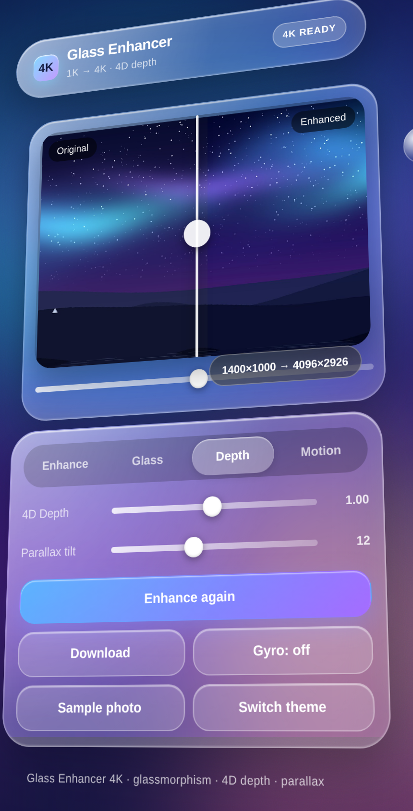
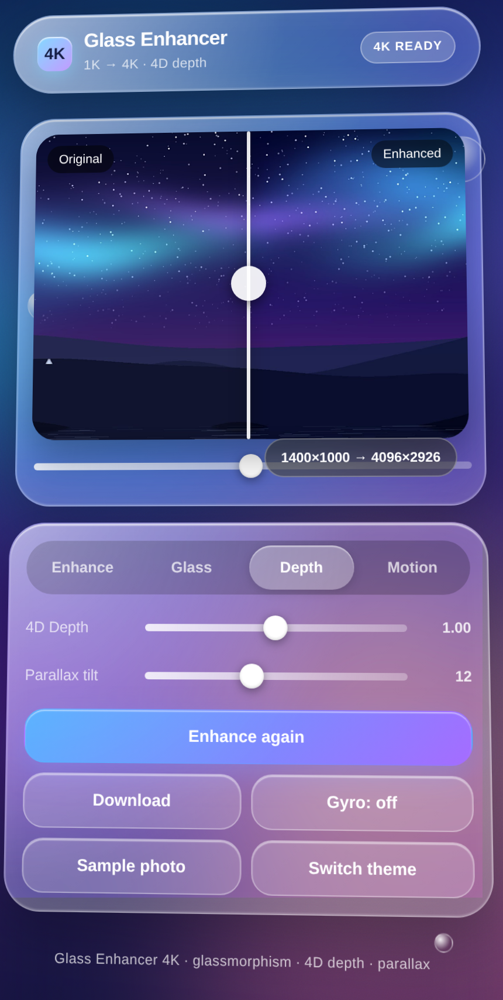
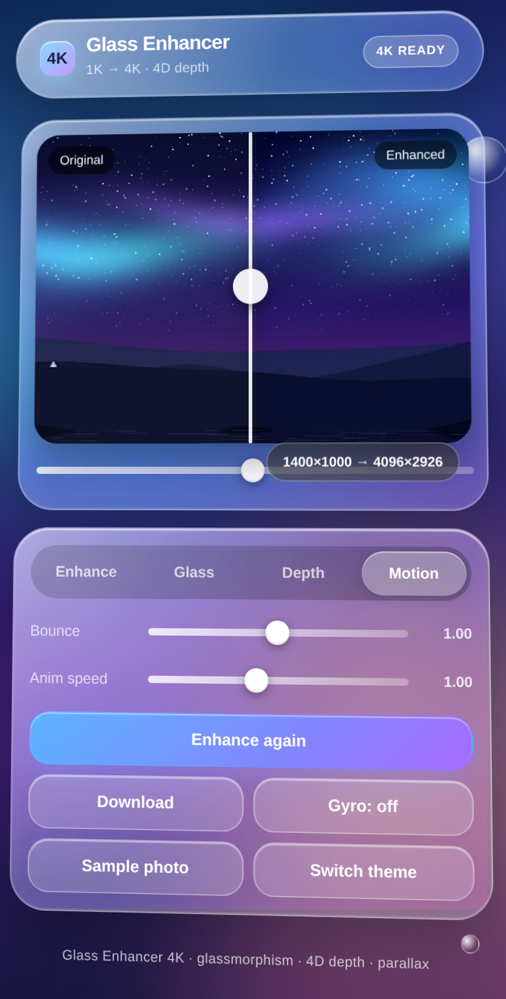
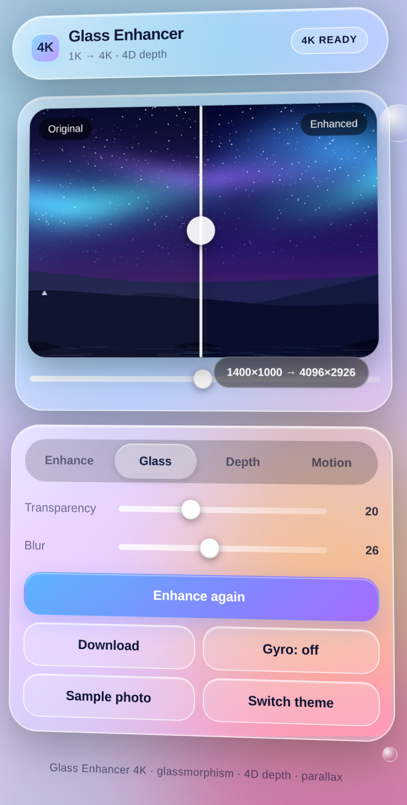

<div align="center">



**Upscale any photo to 4K on your phone — inside a glass UI that moves in 4D.**

[](#install)
[](#install)
[](#how-it-works)
[](#)

</div>

---

Glass Enhancer 4K is a small, fast Android app that takes a low-resolution image and rebuilds it at up to 4096 px on the long edge. Everything runs on the device — no server, no upload, no account. The interface is a layered glassmorphism stack with a real 4D depth system: cards sit at different Z depths, so the whole scene rotates, shifts and parallaxes under your finger or your phone's tilt sensor.



## Features

**Enhance**
- 1K / 2K / 3K / 4K output, picked in one tap
- Progressive 1.6× upscale passes with high-quality resampling, then a per-pixel pass for detail recovery
- Sharpness (unsharp mask), Denoise (blur mix), Contrast and Colour saturation sliders — all live
- Before/after compare slider with a draggable divider
- Shows the exact source and output dimensions on the preview

**Glass**
- Glass transparency and backdrop-blur amount are both adjustable, live

**4D depth**
- `4D Depth` scales every layer's Z translation and the rotation strength
- `Parallax tilt` sets how far the scene rotates in response to the pointer
- Floating glass orbs at three different depths drift at different rates — true parallax, not a shadow trick

**Motion**
- Bounce controls the spring overshoot on the entry animation and every tap
- Anim speed scales the whole animation timeline

**Also**
- Gyroscope tilt control (uses the device orientation sensor, permission handled)
- Dark and light themes, follows your system setting by default
- Drag and drop on desktop browsers
- Sample photo bundled so the app is usable the second it opens

## Install

1. Download `GlassEnhancer4K-v1.0.0.apk` from the [Releases](../../releases) page.
2. On your phone, open the file. Android will ask you to allow installs from this source — allow it for your browser or file manager.
3. Install and open. No permissions are requested up front; camera and gallery access is only used when you tap the drop zone, and saving goes through the system MediaStore into `Pictures/GlassEnhancer`.

Requirements: Android 7.0 (API 24) or newer. The APK is self-signed, so Play Protect may show a "scan" prompt for a sideloaded build — that is normal for any app distributed outside the Play Store.

## Screenshots

| | | |
|:--:|:--:|:--:|
| <br>**Home** | <br>**4K result + compare** | <br>**Glass controls** |
| <br>**Tilt: pointer top-left** | <br>**Tilt: pointer bottom-right** | <br>**Motion controls** |



The depth screenshots are the same app at two different pointer positions — the cards, the header pill and the floating orbs all rotate and shift by different amounts, which is what produces the 4D feel.

## How it works

The app is a single-activity Android shell around one self-contained HTML file. The shell is a `WebView` with JavaScript and DOM storage enabled; the whole interface, the enhancement pipeline and the animation engine live in `app/src/main/assets/index.html`.

**Upscaling.** The image is drawn repeatedly onto intermediate canvases, each step growing by at most 1.6×, using the browser's high-quality resampling. Jumping straight from 1000 px to 4096 px in one draw loses detail; stepping up keeps edges cleaner. Once the target size is reached, a single pass over the pixel buffer applies an unsharp mask (original minus a 3×3 box blur, scaled by the sharpness slider), mixes in the blurred value for denoising, then adjusts luminance-relative contrast and saturation. The loop yields to the UI every 140 rows so the progress counter stays responsive.

**4D depth and parallax.** A `pointermove` (or `deviceorientation`) handler writes normalised `-1…1` values into two CSS custom properties. A `requestAnimationFrame` loop smooths them with a spring (`vx = (vx + (target - current) * 0.05) * damping`), so movement overshoots slightly and settles — that is the bounce slider. Those properties feed three things at once:

```css
.scene   { transform: rotateX(calc(var(--ty) * var(--tilt) * var(--depth) * -1deg))
                     rotateY(calc(var(--tx) * var(--tilt) * var(--depth) * 1deg)); }
.z1      { transform: translateZ(calc(var(--depth) * 46px)); }
.orb.o1  { transform: translate3d(calc(var(--tx) * var(--depth) * -70px),
                                  calc(var(--ty) * var(--depth) * -70px),
                                  calc(var(--depth) * 96px)); }
```

Because each layer has its own Z and its own parallax coefficient, the header, the preview card, the control panel and the orbs separate visually as the scene turns. The glass effect itself is `backdrop-filter: blur() saturate()` plus an inset highlight and a specular radial gradient that tracks the pointer.

**Saving.** In a browser the app falls back to a normal `<a download>` of the canvas PNG. Inside the app, a `@JavascriptInterface` bridge receives the same data URI, decodes it and writes it through `MediaStore` into `Pictures/GlassEnhancer` — so no storage permission is needed on Android 10+.

## Build from source

You need a JDK 17 and the Android SDK (build-tools 34, platform 34). The repo ships a plain `aapt2` → `javac` → `d8` → `apksigner` script, so Gradle is not required:

```bash
export JAVA_HOME=/path/to/jdk-17
export ANDROID_HOME=/path/to/android-sdk
bash build.sh          # writes build/GlassEnhancer4K-v1.0.0.apk
```

`build.sh` creates a release keystore on first run if one is not present and signs the APK with it. For a build you intend to publish, sign with your own key instead.

To work on the interface alone, just open `app/src/main/assets/index.html` in a browser — no build step. A `?demo=1` query string exposes the state hooks used to capture the screenshots (`demo=1&load=1&tab=d&tx=-0.62&ty=-0.34&tilt=17&depth=1.45`).

## Project layout

```
app/src/main/
  AndroidManifest.xml
  java/com/hubclue/glassenhancer4k/MainActivity.java   WebView shell, file chooser, save bridge
  assets/index.html                                    the entire app: UI, pipeline, 4D engine
  assets/sample.jpg                                    bundled sample photo
  res/                                                 launcher icons, theme, strings
screenshots/                                           captured from the app at 430×932 @2x
build.sh                                               SDK-only build, no Gradle
```

## Notes and limits

- The enhancement is a classic resample + unsharp-mask pipeline, not a neural super-resolution model. It sharpens and enlarges very well; it does not invent detail that was never in the frame. A 4K output of a very small source will look crisp but soft in texture — that is the honest result of any non-ML upscaler.
- Very large sources at 4K can take a few seconds on older phones; the progress counter updates as it goes.
- The sample photo is procedurally generated, so the repo carries no third-party image licensing.

## License

MIT — see [LICENSE](LICENSE).
